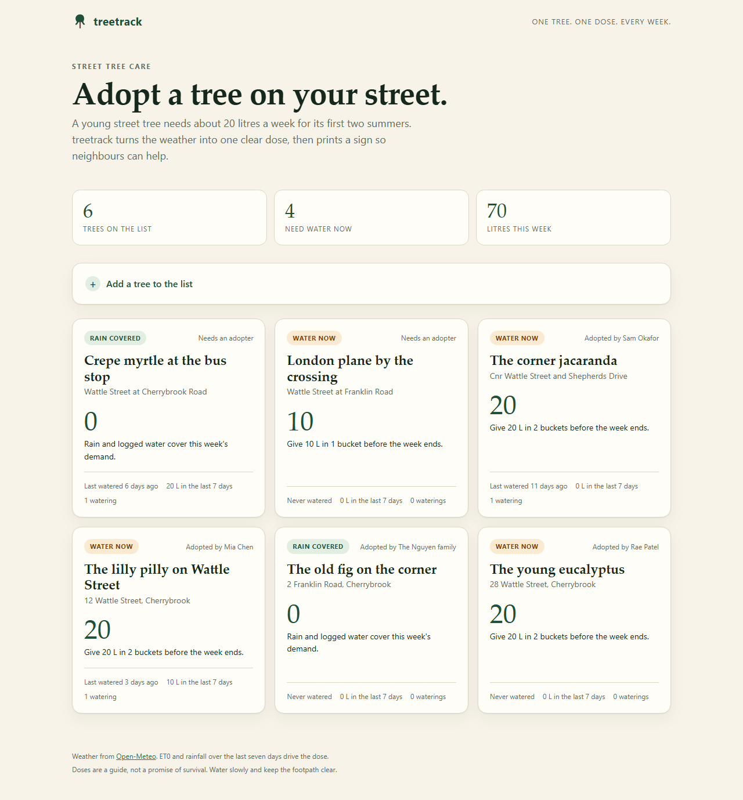
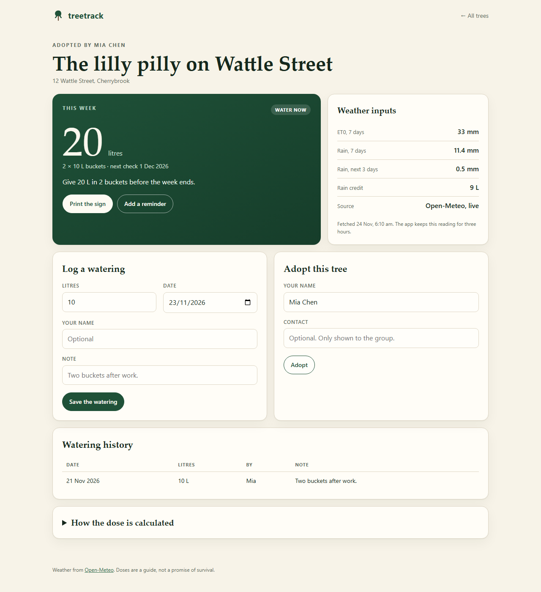
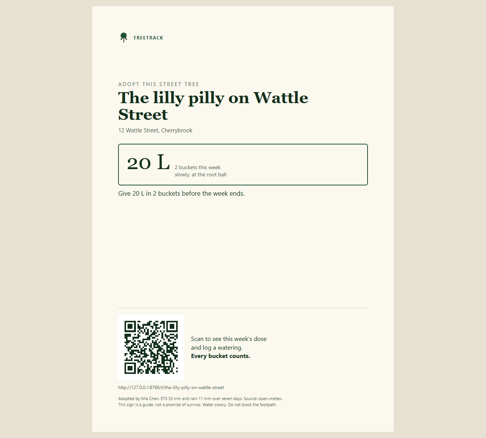

# treetrack

A weekly water dose for one adopted street tree, with a printable QR sign so neighbours can help.

[](LICENSE)
[](tests)
[](https://www.python.org/)

Most young street trees die in their first three years. Water stress is the main cause. A resident can keep one tree alive with one bucket a week. treetrack turns evapotranspiration and rain into that number.

The app answers one question each week: how much water does this tree need today?

## Features

- **One weekly dose.** ET0, rain, tree age, species and mulch become a litre figure and a bucket count.
- **A reason for every dose.** The tree page shows demand, rain credit, logged water and the net gap.
- **Public tree pages.** Neighbours can read the dose, adopt the tree and log a watering.
- **A printable sign.** The A4 sign carries the tree URL as a QR code, so a passer-by can help.
- **Calendar reminders.** Download an ICS file with a weekly event for 12 weeks.
- **Offline fallback.** Enter ET0 and rain by hand when the network is down. The plan still works.

## Quick start

```bash
git clone https://github.com/fuleinist/treetrack.git
cd treetrack
python -m treetrack.server --demo
```

Open <http://127.0.0.1:8765>. The demo adds six trees on one street in Cherrybrook, NSW.

Add `--base-url https://your.host` when you deploy. The sign uses that URL in the QR code.

The server needs Python 3.11 or later. It has no mandatory third-party packages. Install OpenCV for reliable QR codes on long URLs:

```bash
pip install opencv-python-headless
```

Without OpenCV, a bundled encoder handles short URLs.

## Screenshots



*The dashboard shows the week's dose for each tree. Orange means water now. Green means rain covered the demand.*



*A tree page shows the weather inputs, the dose, the watering log and the adoption form.*



*The A4 sign carries the dose and a QR code that opens the public tree page.*

## How the dose works

1. Demand in litres is ET0 over seven days, in millimetres, times the bed area in square metres. One millimetre over one square metre is one litre.
2. A species factor, an age factor and a mulch factor scale the demand. Young trees need more water. Established trees need little.
3. Rain above 2 mm counts as a credit at 80 percent capture. Logged waterings count in full.
4. The result rounds up to whole buckets. A small gap becomes a watch. Forecast rain can hold the watering.

The page shows every input, so a resident can correct the weather or the bed size.

## Data sources

- [Open-Meteo forecast API](https://open-meteo.com/en/docs): `et0_fao_evapotranspiration` and `precipitation_sum` for the past seven days and the next seven days. Free, no key.
- Species, age and mulch factors are advisory. They follow common street-tree establishment guidance of about 20 litres per week for a young tree. Adjust them for your council.

## API

- `GET /api/trees` lists every tree with its plan.
- `POST /api/trees` adds a tree.
- `GET /api/trees/<slug>` returns one tree with its history.
- `POST /api/trees/<slug>/waterings` logs a watering.
- `POST /api/trees/<slug>/adopt` records an adopter.
- `GET /t/<slug>/sign` renders the printable sign.
- `GET /t/<slug>/reminder.ics` downloads the calendar file.
- `POST /api/weather/manual` stores a manual weather reading.

## Limits

- The water balance is an estimate, not a soil sensor.
- Rain is uneven. The app shows the source window and the credit.
- A tree may get water from a lawn or a leak. Log extra water at any time.
- The dose is a guide. The app does not promise survival.

## Tests

```bash
python -m pytest -q
```

The suite covers the water balance, the weather window, QR decoding and the HTTP routes.

## License

MIT. See [LICENSE](LICENSE).